# CV Search RAG

**A recruiter describes the person they need, in Arabic or English. The system returns a ranked shortlist in which every match is cited to the exact part of the CV it comes from.**

`Python` · `PostgreSQL + pgvector` · `Gemini` · `PyMuPDF` · `LlamaParse` · `Google Drive API` · `Streamlit`

---

## Results

16 hand written test cases on 15 CVs, each run twice (32 answers per version). Graded by script, plus an LLM judge for meaning and grounding.

| Metric | Final version (B) |
|---|---|
| Passed all script checks (right candidates, right verdicts, safety) | **94%** (30 of 32) |
| Message right, graded by the LLM judge | **97%** (31 of 32) |
| Reasons backed by the cited CV part | **98%** (170 of 173) |
| Safety: no contact data, no CV from a hidden field | **100%** (32 of 32) |
| Recall@5 | **93%** |
| Time per answer (average / median) | **5.8 s / 5.2 s** |
| Tokens per question (sent / received) | ~2,150 / ~830 |

B is the version kept after an A/B test against the baseline A: one prompt line fixed the salary question in 2 of 2 runs (A: 0 of 2), and nothing else changed. The one case that still fails is a search miss: a CV with the right skill is not among the 5 closest (see Known limitations). The full report, with every case, run and metric: [`data/evaluation/evaluation.md`](data/evaluation/evaluation.md).

---

## What it does

### 1. Intake: CVs arrive on their own and are checked before they are searchable

- **Google Drive watch.** New or changed PDFs in a Drive folder are picked up automatically (the watcher checks about once a minute). Changes are detected with Drive's content fingerprint, so an unchanged file is never processed twice. Duplicates are caught before download.

- **ATS checks** (the format applicant tracking systems can read). A name on the first line, the four core sections (Summary, Work Experience, Education, Skills), dates in the experience section, and a single-column layout without tables. A CV that fails a check is flagged for **review**. A file that can't be read (not a PDF, password-protected, no text, over 20 MB) is marked **failed**.

- **Field classification.** A *field* is a hiring area, such as Cybersecurity. Each CV's average embedding is compared with the 5 fields the company hires for **and 7 fields the company doesn't hire for**. A CV closest to a non-hiring field, far from all fields (score < 0.70), or between two fields (gap < 0.02) goes to review instead of being guessed.

- **Admin review.** Admins see the reasons and the field guess, then approve the CV with a name and field, or reject it.

A CV is `processing` while it moves through the steps, then ends as `ready`, `needs_review`, `failed` or `rejected`. **Only `ready` CVs are searchable.**

### 2. Search: only the CVs the user is allowed to see

The request is embedded as it is written, and one SQL query ranks CVs by their closest chunk. Permissions are part of the **same query**: admins search every field, recruiters only their assigned fields. A hidden CV is never retrieved, so it can never leak into an answer.

### 3. Answer: the model reads, the code decides

The 5 closest CVs are sent to Gemini in full, with every part numbered `[1]`, `[2]`, … and with phone numbers, emails and LinkedIn/GitHub links **removed before the call**. One Gemini call checks every requirement on every CV and returns structured JSON. The code then does everything that must be exact:

| Gemini | Code |
|---|---|
| Reads the request and the CVs | Decides which CVs the user may see (SQL) |
| Marks each requirement as met, partly met (a degree still in progress) or not met, with the parts it rests on | Gives the verdict: any requirement not met → **not a fit**; partly met → **partial** |
| Lists the jobs and their dates | Counts years of experience from those dates (overlapping months once, internships excluded); within 1 year of the limit → **partial** |
| Notices a named person, a vague or contradictory request, or one CVs can't answer (such as salary) | Shows only the named person, or says they are not among the CVs |
| | Shows no candidates under a refusal, a question back or a contact-details answer |
| | Keeps only citations that point to the candidate's own CV |
| | Says what the search could not cover (only the 5 closest CVs were read, or which fields were searched) |

The prompt treats CVs as **data, not instructions**, asks for clarification when a request has nothing to judge, and refuses requests to reveal its instructions or ignore permissions.

---

## Architecture

```mermaid
flowchart LR
    D[Google Drive folder] --> S2[02 Store documents<br/>download, ATS checks]
    S2 --> S3[03 Store chunks<br/>PyMuPDF + section]
    S3 --> S4[04 Embed + classify<br/>Gemini embeddings, field]
    S4 --> DB[(PostgreSQL<br/>+ pgvector)]
    S4 -. ATS problems or unclear field .-> RV[Admin review]
    RV -. approve .-> DB
    DB --> SR[search.py<br/>top 5 CVs the user may see]
    SR --> AN[answer.py<br/>Gemini checks, code decides]
    AN --> UI[Streamlit<br/>Search · Dashboard · Review]
```



---

## Chunking: 16 combinations compared by hand

During development, every combination was built and reviewed before choosing how to split CVs:

**2 extractors** (PyMuPDF, LlamaParse) × **8 strategies** (fixed, token, recursive, sentence, section, semantic, hierarchical, layout) = **16 combinations**. Each review note records the problem found with a concrete example from a real CV, such as fixed-size chunks cutting `Machine Learnin|g`, or `B.Sc.` being read as the end of a sentence. All notes: [`data/manual_review.yaml`](data/manual_review.yaml).

**Selected: PyMuPDF + section.** Each CV section becomes one or more chunks (at most 180 tokens, counted with the embedding model's own tokenizer), never mixing two sections, and tagged with the page and section name, so every citation points to a readable, named part of the CV. The choice is read from `data/manual_review.yaml` (`selected: true`), and the pipeline builds only that combination. In the database it is enforced as unique and switched in one transaction, so search never runs without one.

---

## Evaluation

- **16 test cases in 4 types:** normal, edge (vague request, negation, unknown name), failure (wrong field, salary that no CV contains) and risky (contact details, a recruiter asking for a field they can't see, "ignore the rules").
- **Ground truth written by hand** with explicit rules, for example: a degree counts only when its period has ended; one still in progress is partial.
- **Script metrics:** pass/fail, Recall@5, Precision@5, completeness, ranking, safety, tokens and latency.
- **LLM as a judge:** a different model from the one that answers (Claude Opus 5.5, no tools) grades whether the answer, each reason's grounding and the message are right. Every negative grade in run A was checked by hand against the traces, and all were real errors. The hand checks also found where the judge itself is unstable, and one mistake in its first criteria, which was fixed before grading again.
- **Tracing:** every answer saves the retrieved CVs, the chunks sent, Gemini's raw output and the final answer, so each error is placed in a stage: retrieval, chunking, reasoning or generation.
- **A/B testing:** one change at a time, 2 runs per version, same cases, same judge, same day.

---

## Project layout

| Path | Purpose |
|---|---|
| `01_extract.py` | Development tool: extract text with one or both extractors (for the comparison) |
| `02_store_documents.py` | Download CVs from Drive, run the ATS checks, save them to `documents` |
| `03_store_chunks.py` | Chunk new CVs with the selected combination |
| `04_embed_store_vectors.py` | Embed chunks in batches, assign each CV a field, set its status |
| `05_evaluate.py` | Run the test cases, save results and traces |
| `06_watch_drive.py` | Run steps 02 to 04 in a loop, pausing 60 seconds between passes |
| `07_judge.py` | Grade a run with an LLM judge (calls the `claude` CLI) |
| `export_chunks.py` | Development tool: dump the chunks in the database for manual review |
| `app.py` | Streamlit UI: Search, Dashboard, Review (admin only) |
| `app/` | Extraction, chunking, embedding, search, answering, experience counting, Drive, DB, admin pages |
| `config.py` | Paths, section headings, field thresholds, ATS rules |
| `sql/schema.sql`, `sql/seed.sql` | Database schema, sample fields and users |
| `data/manual_review.yaml` | Review notes for the 16 combinations. Also a pipeline input: step 03 chunks with the entry marked `selected: true` |
| `data/evaluation/` | Test cases (`eval_cases.json`) and the evaluation report (`evaluation.md`) |

---

## Built with

| Tool | Used for |
|---|---|
| [Python](https://www.python.org/downloads/) | All code |
| [PostgreSQL](https://www.postgresql.org/download/) + [pgvector](https://github.com/pgvector/pgvector) | CVs, chunks, vectors, users and permissions |
| [Gemini API](https://ai.google.dev/gemini-api/docs) | Answers (`gemini-3.6-flash-lite`) and [embeddings](https://ai.google.dev/gemini-api/docs/embeddings) (`gemini-embedding-2`) |
| [PyMuPDF](https://pymupdf.readthedocs.io) | PDF text extraction (selected) and the ATS layout checks |
| [LlamaParse](https://developers.llamaindex.ai/llamaparse/) | Second extractor in the chunking comparison |
| [LangChain text splitters](https://pypi.org/project/langchain-text-splitters/) | The recursive strategy in the comparison |
| [Google Drive API](https://developers.google.com/workspace/drive/api/quickstart/python) | CV intake |
| [Streamlit](https://docs.streamlit.io) | Search, Dashboard and Review UI |
| [Claude Code](https://docs.claude.com/en/docs/claude-code/overview) | LLM judge in the evaluation |

---

## Setup

### 1. Get the code

```bash
git clone https://github.com/demaabukwaik-dev/cv-search-rag.git
cd cv-search-rag
python -m venv .venv            # on some Linux systems: python3
source .venv/bin/activate        # Windows: .venv\Scripts\activate
pip install -r requirements.txt
```

Tested with Python 3.14. Run every command in this README from the repository root.

### 2. Start PostgreSQL with pgvector

The easiest way is [Docker](https://docs.docker.com/get-started/get-docker/), with the official [pgvector image](https://github.com/pgvector/pgvector#docker). This creates the database and user from `.env.example` on port 5433:

```bash
docker run -d --name cv-rag-db -e POSTGRES_USER=raguser -e POSTGRES_PASSWORD=change-me -e POSTGRES_DB=ragdb -p 5433:5432 pgvector/pgvector:pg17
```

Then create the tables, the 5 hiring fields and the demo users (one admin, three recruiters). This runs `psql` inside the container, so it doesn't need to be installed on your machine:

```bash
docker exec -i cv-rag-db psql -U raguser -d ragdb < sql/schema.sql
docker exec -i cv-rag-db psql -U raguser -d ragdb < sql/seed.sql
```

With your own PostgreSQL instead, create the database and user, then run the same two files with `psql -h localhost -p 5433 -U raguser -d ragdb -f sql/schema.sql` (and `seed.sql`).

### 3. Get the API keys

| Key | Where | Needed for |
|---|---|---|
| `GEMINI_API_KEY` | [Google AI Studio](https://aistudio.google.com/apikey) | Embeddings and answers (always) |
| `LLAMA_CLOUD_API_KEY` | [LlamaCloud dashboard](https://cloud.llamaindex.ai) | Only the LlamaParse extractor in the comparison (can stay empty) |

### 4. Connect Google Drive

The steps below follow Google's [Drive API Python quickstart](https://developers.google.com/workspace/drive/api/quickstart/python), which has screenshots for each one.

1. In [Google Cloud Console](https://console.cloud.google.com), create a project and enable the **Google Drive API**.
2. Set up the **OAuth consent screen**: user type **External**, publishing status **Testing**, and add your own Google account as a **test user**.
3. Create an **OAuth client ID** of type **Desktop app**, download its JSON file, and save it as `secrets/credentials.json` (create the `secrets/` folder first).
4. Create a Drive folder for the CVs. Its ID is the last part of the folder's URL: `drive.google.com/drive/folders/`**`<this part>`**.

The first time step 02 runs, a browser window opens for sign-in (read-only Drive access), and the token is saved to `secrets/token.json`. This needs a machine with a browser; on WSL, open the link printed in the terminal in your Windows browser. The `secrets/` folder is git-ignored.

### 5. Fill in `.env`

```bash
cp .env.example .env             # Windows cmd: copy .env.example .env
```

Every value except `LLAMA_CLOUD_API_KEY` must be filled in before any script runs, including the app: the settings are read when the code starts.

```env
DB_HOST=localhost
DB_PORT=5433
DB_NAME=ragdb
DB_USER=raguser
DB_PASSWORD=change-me      # the password from step 2

EMBEDDING_MODEL=gemini-embedding-2
EMBEDDING_DIMENSIONS=768   # must match VECTOR(768) in sql/schema.sql

LLAMA_CLOUD_API_KEY=...
GEMINI_API_KEY=...
GENERATION_MODEL=gemini-3.6-flash-lite

DRIVE_FOLDER_ID=...        # from step 4
```

### 6. Add CVs

Upload PDF CVs to the Drive folder. The 15 CVs used during development are not in this repository. The test cases in `data/evaluation/` were written for those 15 CVs, so with other CVs their expected answers must be rewritten.

---

## Usage

### 1. Ingest CVs

Once:

```bash
python 02_store_documents.py
python 03_store_chunks.py
python 04_embed_store_vectors.py
```

Or keep watching the Drive folder:

```bash
python 06_watch_drive.py
```

The watcher runs the three steps, waits 60 seconds, and repeats. It stops if a step fails (for example, a network error), so restart it after fixing the cause.

### 2. Run the app

Ingest at least one CV first: the Dashboard expects CVs in the database.

```bash
streamlit run app.py
```

Choose a user in the sidebar (a demo picker; real sign-in is out of scope). Every user gets **Search** and **Dashboard**; admins also get **Review**.

### 3. Evaluate

```bash
python 05_evaluate.py A1      # writes to data/evaluation/runs/A1/
python 07_judge.py A1         # grades A1 with an LLM judge
```

Results are saved locally in `data/evaluation/runs/A1/` (`results.csv`, `traces.json`, `judge.json`); this folder is git-ignored. The judge needs [Claude Code](https://docs.claude.com/en/docs/claude-code/overview) installed and signed in.

---

## Engineering notes

- **Fewer API calls.** Embeddings, token counts and extracted text are cached on disk, so re-running a step doesn't pay twice. While the app is running, an identical question is answered from cache.
- **Safe concurrent runs.** Embedding takes a Postgres advisory lock, so only one run embeds at a time. Each CV's chunks are saved in one transaction: all of them or none.
- **Self-healing index.** If the selected chunking settings change, the old chunks are deleted and rebuilt on the next run. A changed CV loses its old chunks automatically.
- **Built for the free tier.** Embedding calls wait and retry when Gemini's rate limit is hit. Answer calls time out after 30 seconds, and the UI shows a clear message (limit reached, Gemini busy, connection lost) instead of an error.
- **Arabic and English.** Answers are written in Arabic for an Arabic request and in English otherwise, and English terms inside Arabic text are kept in the right order.

## Known limitations

- Only the 5 closest CVs are read per request. Whenever a candidate fits, the answer notes that more may exist beyond those 5.
- A long section can still split one job across two chunks. The full CV is sent to the model, so the answer is not affected, but the citation may point to only part of the job.
- Search is by meaning only, so a CV with the exact skill can rank below one that only sounds close (in the evaluation, a Java developer was read instead of a candidate with Python). Next step: hybrid search, meaning plus exact words.
- The contact-details message sometimes writes the button name in Arabic instead of "Open CV (PDF)". Next step: let the code write that message.
- Latency in the evaluation was measured on a day when Gemini was slower than usual; it should be measured again.